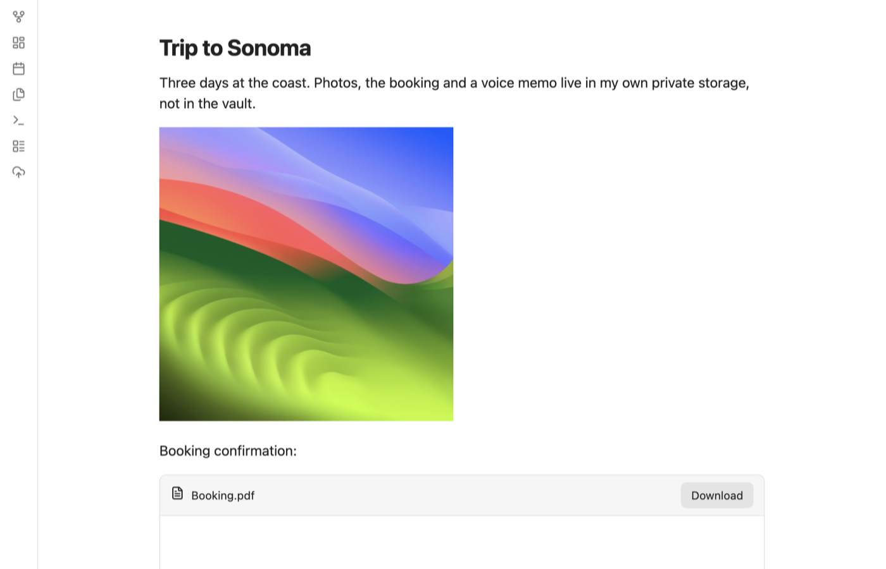
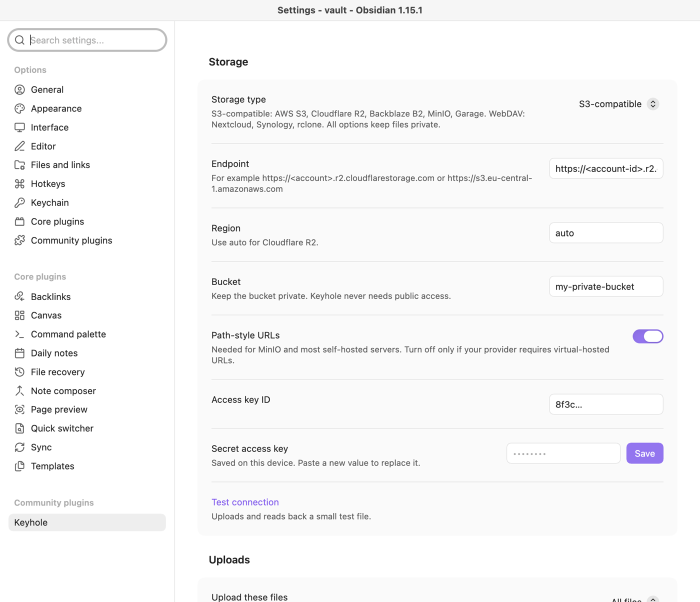
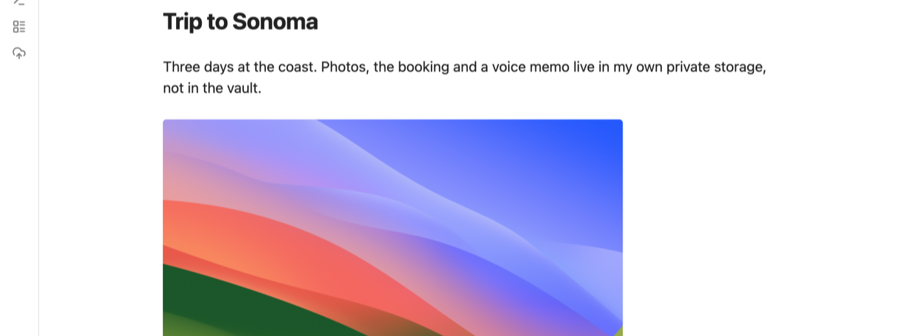

# Keyhole

Keep your attachments on your own private storage. Drop or paste an image, PDF, recording, video or any other file into a note. Keyhole uploads it to your S3-compatible bucket or your own server and writes the link for you. When you view the note, Keyhole fetches the file with credentials that are stored only on your device. Your vault stays small, and the files stay private.

- **Private by design:** nothing is publicly readable. Notes contain only `keyhole://` links, never tokens or signed URLs.
- **Secrets stay on the device:** secret keys, tokens and passwords live in Obsidian's keychain, not in your vault, so they are never synced or committed to Git.
- **Works where attachments work:** Reading view, Live Preview, hover previews, Canvas and the image viewer, on desktop and mobile.
- **All kinds of files:**
  - images;
  - PDFs, rendered in the note;
  - audio and video, streamed from S3 or the Keyhole server;
  - any other file, as a download card.
- **Offline:** files you have viewed are kept on the device, up to a size limit you choose.
- **Upload many files at once:** the *Upload files* button opens your system's picker with multi-select. On a phone that means the photo library, the camera or the Files app.
- **Never lose a file:** if an upload fails (you are offline, say), the file is saved as a normal local attachment instead.



> Status: beta. Tested on macOS and iPhone; Android still needs testing. Design notes: [docs/CONCEPT.md](docs/CONCEPT.md).

## Storage you can use

| Storage | Examples |
|---|---|
| S3-compatible | AWS S3, Cloudflare R2, Backblaze B2, Wasabi, Garage, SeaweedFS, MinIO |
| Keyhole server | The small server in [`server/`](server/): one file, no dependencies, Docker image |
| WebDAV | Nextcloud, Synology, rclone `serve webdav`, Caddy, nginx |

Keep your bucket **private**. Keyhole never needs public access, and it needs no CORS configuration.

## Install

Keyhole is not in the community plugin directory yet. Until it is, install it with [BRAT](https://github.com/TfTHacker/obsidian42-brat):

1. Install **BRAT** from *Settings → Community plugins → Browse* and enable it.
2. Run the command **BRAT: Add a beta plugin for testing** and enter `dbraendle/obsidian-keyhole`.
3. BRAT installs Keyhole, keeps it up to date and, if you use Obsidian Sync with community plugins enabled, your other devices get it too.

Manual install: download `main.js`, `manifest.json` and `styles.css` from the [latest release](https://github.com/dbraendle/obsidian-keyhole/releases/latest) into `<vault>/.obsidian/plugins/keyhole/`.

## Setup



1. Enable Keyhole under *Settings → Community plugins*.
2. Open **Settings → Keyhole** and choose your storage.
3. Enter the endpoint, bucket and access key ID, or your server URL.
4. Paste the **Secret access key** (or **Token or password**) and press **Save**. It is stored in this device's keychain, not in the vault, so do this once on every device.
5. Click **Test connection**.

### Cloudflare R2 example

- Endpoint: `https://<account-id>.r2.cloudflarestorage.com`
- Region: `auto`
- Bucket: your private bucket
- Credentials: an R2 API token with *Object Read & Write* on that bucket only

### Keyhole server

```sh
docker run -d -p 127.0.0.1:8080:8080 -v keyhole-data:/data \
  -e KEYHOLE_TOKENS="$(openssl rand -hex 32)" ghcr.io/dbraendle/keyhole-server:latest
```

Put it behind HTTPS with a publicly trusted certificate (iOS ignores self-installed ones). Then use `https://your-host/f/` as the server URL. See [server/README.md](server/README.md).

## Using it

- **Drop or paste** files into a note. Keyhole takes files that match *Upload these files* and are under the size limit; everything else is left to Obsidian. Images are shrunk on the device first (configurable).
- **Upload files** (ribbon icon, command palette or the editor's context menu) picks several files at once. On phones Keyhole offers to put this button next to the paper clip in the toolbar.
- **Right-click a Keyhole file** (long-press on mobile) to open it, copy its link, download or share it, bring it back into the vault, or delete it from your storage.
- **Links work too:** `[Booking](keyhole://…)` without the `!` is a plain link; tapping it opens the file.
- Links look like ``. Resize images as usual: ``.

### Moving existing attachments



Notes that still have local attachments show a small bar: **Move to Keyhole** uploads them (images shrunk), rewrites the embeds (sizes like `|300` are kept) and moves the local files to the trash. Files that other notes or canvases still use are kept. Shrinking is lossy: if you want to keep originals in full quality, switch off *Shrink images before upload* or *Remove local copies after moving* first. The same is available as a command and in the note's ⋯ menu.

### Your way out

**Bring all Keyhole files back into the vault** (settings or command palette) turns every Keyhole file into a normal attachment again. Your storage keeps its copies. You are never locked in.

### Keeping the storage tidy

Deleting a link does not delete the file. **Clean up storage** compares your storage with the notes of this vault and lists files no note uses anymore; you pick what to delete. Only files that Keyhole uploaded under this vault's key prefix are listed, never other files in the same bucket. Deleting is permanent unless your storage keeps versions. Files from the last 7 days are hidden by default, because notes on other devices may not have synced yet.

### Offline

Files you have viewed stay on the device (size limit in the settings). **Keep attachments of the current note on this device** downloads all of a note's files ahead of a trip.

## Languages

Keyhole follows Obsidian's interface language. Available: English, German. Translations are welcome: copy `src/i18n/en.ts` to a new file named after the language code and register it in `src/i18n/index.ts`.

## Privacy and network use

Keyhole connects **only** to the storage you configure, to upload and download your files. It sends no telemetry and contacts no other service. You need an account with an S3-compatible provider (often paid beyond a free tier), or your own server.

- **Secrets** (secret access key, token, password) are stored in Obsidian's keychain on each device. Each one is tied to the server it was saved for: if the storage address in the settings changes to another host, Keyhole asks for the secret again instead of sending it there.
- **Settings** are stored in the plugin's `data.json` inside your vault, like for every plugin, and are synced with it if you sync plugin settings. They contain the storage address, bucket, access key ID and WebDAV user name, but no secrets.
- Obsidian does not separate plugins from each other: other plugins you install can read the keychain and the files shown in your notes. Only install plugins you trust.
- **The offline cache** lives in the app's local storage (IndexedDB) on each device, outside your vault and not encrypted by Keyhole. It stays there when you remove the plugin: run **Clear offline cache on this device** first.
- **What your storage provider sees:** the files themselves and their names. The file name is part of the key (`2026/11/3f2a…-photo.jpg`), so it appears in the provider's listings and logs. Keyhole does not encrypt files; use a provider or server you trust.
- **Images** are shrunk on your device, never by a service. Re-encoding removes metadata such as the location; an image that is uploaded unchanged (GIF, SVG, already small, or shrinking switched off) keeps its metadata.
- To stream audio and video, Keyhole gives the media player a signed link that expires after a few hours. This is a presigned URL for S3, or an HMAC-signed URL for the Keyhole server. These links exist only while the note is open and are never written to your notes.
- **Reading your notes:** "Clean up storage" and "Restore all notes" go through every note in the vault, to find which stored files are still linked and which notes contain Keyhole links. Keyhole only looks for `keyhole://` links and never sends note contents anywhere.
- **Clipboard:** when you paste, Keyhole checks whether the clipboard holds files (which it uploads) or text (which it leaves to Obsidian). It writes to the clipboard in two cases: when you choose "Copy link" on a file, and when an upload finishes after you deleted its placeholder from the note (the finished link is put on the clipboard so it is not lost).
- **Release files** carry GitHub artifact attestations, so you can check that `main.js` and `styles.css` were built from this repository: `gh attestation verify main.js -R dbraendle/obsidian-keyhole`.

## Limitations

- Without Keyhole installed, the embeds show as broken images. The links contain the file name, so nothing is lost, and *Bring all Keyhole files back* restores normal attachments at any time.
- Obsidian Publish cannot show Keyhole files.
- Plain WebDAV downloads media completely before playback. Use S3 or the Keyhole server for large videos.
- On mobile, very large files can run into memory limits during upload. The default maximum is 100 MB.

## Development

```sh
pnpm install
pnpm dev        # watch build into main.js
pnpm check      # lint, tests, production build
pnpm smoke:s3   # SigV4 against a real S3 server (see test/integration/s3-smoke.ts)
```

## License

[MIT](LICENSE)
